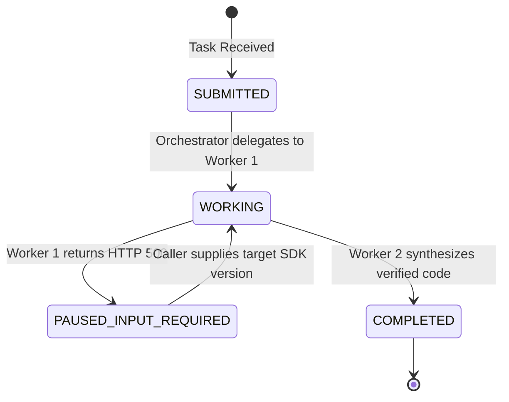

# Bonus Challenge: Agent-to-Agent (A2A) Protocol Specification

## 1. Orchestrator AgentCard

The Orchestrator defines its capabilities, interface contracts, and access control in [`agent_card.json`](file:///c:/Users/uttam/Documents/GIT%20PROJECTS/ai-learning/agent_card.json):

```json
{
  "agent_id": "urn:agent:devdocs:orchestrator-squad",
  "name": "SDK Migration Orchestrator Squad",
  "version": "1.0.0",
  "capabilities": [
    "sdk_migration_orchestration",
    "version_deprecation_audit",
    "openapi_code_synthesis"
  ],
  "authentication": {
    "type": "bearer_token",
    "scope": "sdk:migrate:execute"
  }
}
```

---

## 2. A2A Task State Machine: HTTP 500 Failure Mapping

Standard point-to-point systems fail with unrecoverable exceptions when a dependency errors. Under the formal **A2A Task State Machine**, inter-agent failures trigger lifecycle state transitions that enable human-in-the-loop or caller recovery:



### Lifecycle Transition Trace for HTTP 500 Case:
1. **`SUBMITTED` $\rightarrow$ `WORKING`**: Orchestrator accepts migration query and delegates deprecation check to Worker 1.
2. **`WORKING` $\rightarrow$ `PAUSED: input-required`**: Worker 1 encounters an internal registry timeout (`HTTP 500`). Rather than terminating the entire migration as `FAILED`, the task transitions to `PAUSED: input-required` with prompt:
   > *"Deprecation registry lookup failed (HTTP 500). Please confirm or provide your target SDK version (e.g. 'v3') to proceed with code generation."*
3. **`PAUSED: input-required` $\rightarrow$ `WORKING`**: Caller confirms target version (`"v3"`), resuming execution.
4. **`WORKING` $\rightarrow$ `COMPLETED`**: Worker 2 queries active OpenAPI schemas, generates executable code, and marks the task `COMPLETED` with appropriate degradation notes.

---

## 3. Protocol Value Statement (Exactly 2 Lines)

Line 1: Formal A2A protocols provide standardized task state lifecycles (such as PAUSED: input-required, async polling, and cancellation) and schema-negotiated capability discovery (AgentCards) that generic point-to-point REST endpoints lack.  
Line 2: They decouple agent identity, contract validation, and multi-turn context boundaries, preventing brittle, ad-hoc glue code from proliferating as agent topologies evolve.
