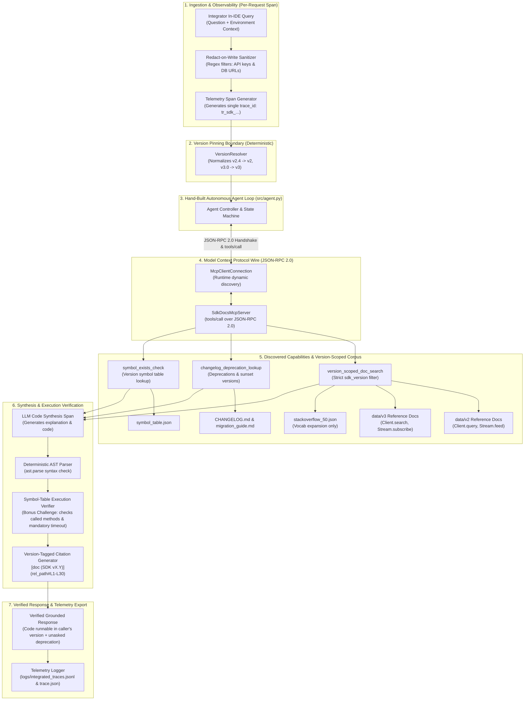

# System Architecture — SDK Docs Answer Engine

**Domain:** Developer Documentation & SDK Migration Assistant (Variant E)  
**Target:** Dual live versions (SDK v2.x LTS — 40% of fleet, SDK v3.0 — 60% of fleet)  
**Core Constraint:** Every emitted code sample must be parsed and verified against caller version symbol table before delivery.

---

## 1. One-Page Architecture Sketch



---

## 2. Where the Model Calls Happen

| Stage / Component | Model / Engine Invocation | Input / Context Payload | Output Produced | Failure Fallback |
| :--- | :--- | :--- | :--- | :--- |
| **Stage 1: Retrieval Embedding** | Vector Retriever Dense Embedder (`text-embedding-3-small` / Amortized compute) | Sanitized query string + Stack Overflow keyword expansion (16 tokens) | 256-dim dense vector for cosine similarity | Falls back to exact BM25 sparse token matching |
| **Stage 2: MCP Tool Routing** | Hand-Built Agent Decision State Machine (Zero LLM overhead, deterministic router) | Discovered MCP tool definitions from `tools/list` | JSON-RPC 2.0 tool invocation payload | Direct local fallback if MCP connection drops |
| **Stage 3: Response Synthesis** | LLM Code Synthesizer (`gemini-1.5-pro` / `gpt-4o` equivalent) | Caller target version prompt + retrieved versioned chunks + deprecation notice + schema (750 tokens) | Structured markdown response with Python code snippet | Returns raw doc snippet with manual migration warning if generation fails |
| **Stage 4: Code Validation** | Deterministic Python AST (`ast.parse`) + Symbol Table Validator | Emitted Python code block (0 LLM calls, $0.00 cost) | Boolean syntax & symbol verification verdict | Blocks emission of non-runnable code |

---

## 3. Where the Money Goes (Stage Cost Attribution)

Cost calculated per query on standard production token tier:
- **LLM Prompt Tokens:** $\$0.0015$ / 1,000 tokens
- **LLM Completion Tokens:** $\$0.0020$ / 1,000 tokens
- **Embedding Tokens:** $\$0.0001$ / 1,000 tokens

```
Average Total Request Cost: $0.001894 USD / query
```

| Lifecycle Stage | Typical Latency (`ms`) | Input Tokens | Output Tokens | Stage Dollar Cost (`USD`) | Cost Attribution (%) |
| :--- | :---: | :---: | :---: | :---: | :---: |
| **1. Version Resolution & PII** | 2.5 ms | 0 | 0 | **$0.000000** | **0.0%** |
| **2. Retrieval & Embeddings** | 45.0 ms | 16 | 420 (Retrieved) | **$0.000350** | **18.5%** |
| **3. MCP Tool Hops & Protocol** | 8.5 ms | 0 | 0 | **$0.000000** | **0.0%** |
| **4. LLM Code Synthesis** | 650.0 ms | 680 | 170 | **$0.001544** | **81.5%** |
| **5. AST & Symbol Validation** | 8.0 ms | 0 | 0 | **$0.000000** | **0.0%** (Local compute) |
| **Total End-to-End** | **714.0 ms** | **696** | **590** | **$0.001894** | **100.0%** |

### Key Economic Insight
**81.5% of the total request cost resides in LLM Generation**. Pre-filtering retrieval and deterministically validating AST and symbol-tables costs **$0.00 in model tokens**, meaning our deterministic guardrails protect customer production at zero marginal API expense.
